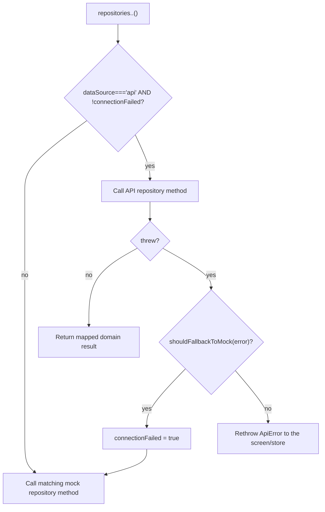

# API Integration

> **Read this first:** the backend contract is [`API.md`](../API.md). It is the authoritative reference and is **not modified** by this documentation. This file describes what the app actually does with that contract. No live backend was available during verification.

## 1. Current status (important)

| Question | Answer |
|---|---|
| Is a backend connected? | **No.** Default data source is `mock`. |
| Is any network request sent at startup? | **No.** `src/api/client.ts` is never imported by mock repositories. |
| Is API mode implemented? | Prepared and unit-tested with a mocked `fetch`; **not verified against a real server**. |
| What happens if the server is unreachable in API mode? | The app switches all repositories to local mock data **for the rest of the session**. |
| Are there in-app toggles for the data source? | No. It is read from `EXPO_PUBLIC_DATA_SOURCE` at startup only. |

## 2. Configuration

`src/config/environment.ts` exposes:

```ts
export type DataSource = "mock" | "api";

export interface AppEnvironment {
  dataSource: DataSource;
  apiBaseUrl: string;
  storeId: string;
  timeoutMs: number;
}
```

| Variable | Default | Parsing rule |
|---|---|---|
| `EXPO_PUBLIC_DATA_SOURCE` | `mock` | Only the exact lowercase string `api` opts in. `"API"`, typos, empty values and `mock` stay in mock mode. |
| `EXPO_PUBLIC_API_BASE_URL` | `http://localhost:3000` | Trailing slashes removed; value is the documented development URL. |
| `EXPO_PUBLIC_STORE_ID` | `""` | Trimmed. Must come from the dashboard / Salla merchant ID — never invented. |
| `EXPO_PUBLIC_API_TIMEOUT_MS` | `15000` | Positive finite numbers only; anything else → `15000`. |

Documented base URLs are also exported as `DOCUMENTED_BASE_URLS = { development: "http://localhost:3000", production: "https://api.mokkafa.com" }`.

`src/api/client.ts` keeps a mutable `ApiConfig { baseUrl, storeId, timeoutMs }` seeded at import time from `getEnvironment()`. `configureApi()` and `resetApiClientForTests()` are test hooks. `assertApiReady()` throws `configurationError` if base URL or store ID is missing, which prevents a request to a made-up URL.

To enable API mode (only once a real backend is available):

```powershell
Copy-Item .env.example .env
# set EXPO_PUBLIC_DATA_SOURCE=api, EXPO_PUBLIC_API_BASE_URL, EXPO_PUBLIC_STORE_ID
npx expo start -c
```

`EXPO_PUBLIC_*` values are bundled into the app — never put passwords or secrets there.

## 3. Documented endpoints and actual usage

All paths are built by `src/api/endpoints.ts` (`API_PATHS`, aliased as `ENDPOINTS`). Every path starts with `/v1/store/:storeId`, where the store id comes from configuration at call time.

| Endpoint (`API.md`) | API helper | Wired to UI? | Notes |
|---|---|---|---|
| `GET /v1/store/:storeId/config` | `API_PATHS.config` → `apiStoreConfigRepository.get()` | **No** | Local `store-configs/index.ts` stays authoritative; mapping exists. |
| `POST /v1/store/:storeId/auth/otp/request` | `API_PATHS.auth.requestOtp` → `apiAuthRepository.sendOtp` | **Yes** (api mode) | Phone digits only; ignores `debug_code`. |
| `POST /v1/store/:storeId/auth/otp/verify` | `API_PATHS.auth.verifyOtp` → `apiAuthRepository.verifyOtp` | **Yes** (api mode) | Stores JWT in SecureStore; optional `name` for new customers. |
| `GET /v1/store/:storeId/categories` | `API_PATHS.catalog.categories` → `apiCatalogRepository.listCategories()` | **No** | Screens use local `MAIN_CATEGORIES`. |
| `GET /v1/store/:storeId/products` | `API_PATHS.catalog.products` → `listProducts()`, `listProductsPaged()`, `search()` | **Yes** (catalogue via `useCatalogProducts`, search screen) | Only `page`, `per_page`, `category_id`, `search` are sent. |
| `GET /v1/store/:storeId/products/:productId` | `API_PATHS.catalog.product` → `getProduct()` | **No** | Product screen uses the shared catalogue from `listProducts()`. |
| `GET /v1/store/:storeId/me` | `API_PATHS.profile.me` → `apiProfileRepository.get()`, `apiAuthRepository.restoreSession()` | Partly | Used for session restore; the account screen reads the auth store, not the profile repository. |
| `PUT /v1/store/:storeId/me` | `apiProfileRepository.update()` | **No** | Prepared only. |
| `GET /v1/store/:storeId/me/addresses` | `apiAddressRepository.list()` | **Yes** | Addresses and checkout screens. |
| `POST /v1/store/:storeId/me/addresses` | `apiAddressRepository.add()` | **Yes** | POST response shape is not documented; the app ignores it and calls `list()` again. |
| `GET /v1/store/:storeId/cart` | `apiCartRepository.get()` | **No** | Prepared for future server-sync; UI cart is local. |
| `POST /v1/store/:storeId/cart/items` | `apiCartRepository.add()` | **No** | Same. |
| `PUT /v1/store/:storeId/cart/items/:itemId` | `apiCartRepository.setQuantity()` | **No** | Same. |
| `DELETE /v1/store/:storeId/cart/items/:itemId` | `apiCartRepository.remove()` | **No** | Same. |
| `DELETE /v1/store/:storeId/cart` | `apiCartRepository.clear()` | **No** | Same. |
| `POST /v1/store/:storeId/orders` | `apiOrderRepository.create()` | **Yes** | Checkout sends only `addressId`, `paymentMethod: "cod"`, `note`. |
| `GET /v1/store/:storeId/orders` | `apiOrderRepository.list()` | **Yes** | Orders screen. |
| `GET /v1/store/:storeId/orders/:orderId` | `apiOrderRepository.get()` | **Yes** | Order detail screen. |

### Functionality deliberately **not** assumed

`API.md` does **not** document any of the following, so no paths or schemas were invented:

- **Wishlist endpoints.** `useWishlistStore` is the only wishlist implementation in both modes. A future sync requires new backend documentation.
- **Structured product variations.** The documented product has `mainImage`, `images`, one price, `quantity` and `sku` — no `colors`, `sizes`, colour-specific prices/images, combination stock or availability. `mapApiProduct` therefore sets `colors: []`, `sizes: []`, `variations: []`. **Do not fabricate a variation schema.**
- **Generic email/password login or registration.** `apiAuthRepository.login/register` return `apiUnsupportedAuth`; only OTP is documented.
- **Payment-method or shipping-method endpoints.** Checkout UI offers `card`, but the API repository sends `paymentMethod` only when it is exactly `cod`.
- **Currency-rate endpoints.** Rates are local illustrative constants in `src/utils/currency.ts`.
- **Notification endpoints.** Notifications always use local seed data.
- **Address `recipient` / `label` fields.** The API repository uses the profile name as recipient and a fixed local label.
- **Detailed order-item fields.** Documented items have no `productId` or image; mappers use `productId: 0` and `image: ""`.
- **`debug_code`** is development-only (`OTP_DEBUG=true`) and is never read by the app.
- **POST address response shape** is not documented; the client does not assume one.

## 4. API client

`src/api/client.ts` owns one transport implementation for all repositories:

- `apiClient.get<T>(path, options?)`, `.post<T>(path, body?, options?)`, `.put<T>(...)`, `.delete<T>(...)`.
- `RequestOptions` supports `method`, `body`, `token` override and `query` (undefined/null values are omitted and keys/values are URL-encoded by `buildUrl`).
- Headers: `Accept: application/json`, `Content-Type: application/json`, and `Authorization: Bearer <token>` when a token resolves.
- Body is JSON-stringified only when defined.
- Timeout uses `AbortController` when available; on abort, `normalizeApiError` produces a `timeout` error.
- On 401/403 the registered `unauthorizedHandler` is invoked (token cleared), but the original error is preserved.
- Empty response body resolves to `undefined as T`; invalid JSON throws `ApiError(..., "invalid-response")`.
- `setConnectionFailureHandler` lets the repository registry learn about infrastructure failures; `setAuthTokenProvider` and `setUnauthorizedHandler` are wired by `src/api/token.ts` **only when API mode is enabled**.

```ts
// src/api/client.ts (actual shape)
export interface ApiConfig { baseUrl: string; storeId: string; timeoutMs: number }
export interface RequestOptions {
  method?: "GET" | "POST" | "PUT" | "DELETE";
  body?: unknown;
  token?: string | null;
  query?: Record<string, string | number | boolean | undefined | null>;
}
```

## 5. Authentication and token handling

`src/api/token.ts`:

| Item | Value / behaviour |
|---|---|
| Token key | `naseej:customer-jwt` in `expo-secure-store` |
| Demo token key | `naseej:session` (different key, used only by `mockAuthRepository`) |
| `readCustomerToken()` | Returns token or `null`; SecureStore errors are swallowed (web preview). |
| `saveCustomerToken(token)` / `clearCustomerToken()` | Non-fatal on failure. |
| `installCustomerTokenProvider()` | Registers `readCustomerToken` as the client's token provider and clears the token on 401/403. |

OTP flow in API mode:

1. `normalizePhoneForApi(phone)` strips non-digits and a leading `00` (e.g. `+966 50…` → `96650…`).
2. `POST /auth/otp/request` with `{ phone }`; response must contain a boolean `sent`. `debug_code` is ignored.
3. `POST /auth/otp/verify` with `{ phone, code, name? }`; response must include `token` and `customer.id`.
4. Token is saved to SecureStore and the customer is mapped to the app's `User`.
5. Email/password methods remain for backward compatibility but are unsupported in API mode.

`loginWithPhone` / `registerWithPhone` use a `skipNextOtpRequest` flag so the store's follow-up `requestOtp()` call does not send a duplicate OTP request. `pendingName` carries the registration name into verification (the documented API has no separate register endpoint).

## 6. Response mapping

`src/api/mappers.ts` is the **only** place allowed to interpret remote fields. Screens never receive `ApiProduct`/`ApiCart`/`ApiOrder` objects.

| Mapper | Output | Notable rules |
|---|---|---|
| `mapApiProduct` | `Product` | Stable numeric id via FNV-1a hash registry (`remoteProductIdToLocalId` / `resolveRemoteProductId`); derived slug `product-<id>`; sale price → `price`, original → `compareAt`; neutral rating/reviewCount; empty variation arrays. |
| `mapApiProductPage` | `Product[]` | Maps `page.data`. |
| `mapApiCategory` | `Category` | `imageUrl` → `image`, empty string when absent. |
| `mapApiCustomer` / `mapApiProfile` | `User` | Nullable name/email become empty strings. |
| `mapApiAddress` | `Address` | Combines district/street/details into `line`; local label; recipient passed by caller. |
| `mapApiCartItem` / `mapApiCart` | `CartItem[]` | `options.color`/`options.size` are labels only; `colorId`/`sizeId` remain `null`, `variationId = "api:<itemId>"`, `sku = ""`, `stock = null`. |
| `mapApiOrderStatus` | `OrderStatus` | `SHIPPED`→`shipped`, `DELIVERED`→`delivered`, `CANCELLED`/`REFUNDED`→`cancelled`, others→`processing`. |
| `mapApiOrder` | `Order` | Only grand total available → `subtotal = total`, `deliveryFee = 0`, `discount = 0`; missing `createdAt` → epoch; `isDemo: false`; `productId: 0`, empty image for lines. |
| `mapApiStoreConfig` | `StoreConfigSnapshot` | Currency falls back to `SAR` for unknown codes. |

`parseApiAmount()` guarantees no `NaN` reaches price calculations. `resetRemoteIdRegistry()` is a test hook.

## 7. Error handling and fallback behaviour

`src/api/errors.ts`:

- `ApiErrorKind = "http" | "network" | "timeout" | "invalid-response" | "not-configured" | "not-found"`.
- `ApiError.status`, `.kind`, `.code` (e.g. `api401`, `apinetwork`), and getters `isUnauthorized`, `isTimeout`, `isNotFound`.
- `API_STATUS_MESSAGES` covers 400, 401, 403, 404, 429, 500, 502, 503, 504 with short safe messages.
- `shouldFallbackToMock(error)` returns true for `network`, `timeout`, `invalid-response`, `not-configured`, and HTTP 500/502/503/504.
- `src/api/errorMessages.ts` maps these to `TranslationKey` values (`apiNetworkError`, `apiTimeout`, `apiUnauthorized`, `apiForbidden`, `apiNotFound`, `apiRateLimited`, `apiUnavailable`, `apiNotConfigured`, `apiUnexpectedResponse`, …).

`src/repositories/index.ts` implements fallback with a `Proxy`:



**What the user sees when the backend is unavailable:** the affected call uses local demo data instead of failing. `getRepositorySource()` then returns `"mock"`, and the home screen displays the mock/API source notice derived from it. There is **no automatic retry** in the same session; restart the app to try the API again. A missing Store ID falls back without sending any request.

**What does not fall back:** HTTP 400 (validation), 401/403 (auth), 404 (not found; `getProduct`/`getOrder` return `undefined`) and 429 (rate limit). These remain real errors — the app never pretends an auth or validation failure succeeded.

## 8. Mock vs API: what is real

| Operation | Mock mode (default) | API mode, server healthy |
|---|---|---|
| Catalogue browsing | `PRODUCTS` from `src/data/products.ts`, full variation data. | `GET /products` with 100 items, no variations. |
| Search | Local token filter over both locales. | `GET /products?search=...` (no language param). |
| Category tiles | Local `MAIN_CATEGORIES`. | Local (category endpoint not wired). |
| Auth | Local accounts, any 4 digits accepted, no SMS, predictable token. | Real OTP request/verify, JWT in SecureStore. |
| Cart | Always local Zustand store + AsyncStorage. | Still local in the UI; API cart repository exists but is unused. |
| Wishlist | Always local AsyncStorage. | Still local (no documented endpoints). |
| Addresses | AsyncStorage seeds and additions. | `/me/addresses` GET/POST. |
| Orders | AsyncStorage demo orders, locally generated id. | `POST /orders` sends only documented fields; list/detail via GET. |
| Notifications | Local seed data. | Local seed data. |
| Store config | Local `store-configs/index.ts`. | Local; `/config` prepared but unused. |
| Currency | Local illustrative rates. | Local illustrative rates. |

## 9. Integration checklist for a backend team

1. Confirm base URL and obtain a real Store ID from the dashboard / Salla merchant ID.
2. Enable API mode via `.env` and restart Expo (`npx expo start -c`).
3. Verify `GET /v1/store/:storeId/config` responds (PowerShell: `Invoke-RestMethod -Uri "http://localhost:3000/v1/store/<STORE_ID>/config"`).
4. Verify OTP request/verify with a real test number; confirm `Authorization: Bearer` on protected routes.
5. Confirm the documented product schema is sufficient. If variations are required, extend `API.md` **first**, then update `src/api/types.ts`, `src/api/mappers.ts` and the variation boundary — do not invent fields in the app.
6. If wishlist sync, card payments, shipping methods or live currency rates are required, document those endpoints before wiring them.
7. Run `npm test -- --runInBand`, `npm run typecheck`, `npm run lint` after any API change. Existing tests assert that no undocumented path or field is sent.

## 10. Related documents

- [API.md](../API.md) — backend contract (do not modify).
- [API_INTEGRATION_GUIDE.md](../API_INTEGRATION_GUIDE.md) — existing Arabic beginner guide to the prepared integration.
- [DATA_FLOW.md](DATA_FLOW.md) — request/response flowcharts.
- [TROUBLESHOOTING.md](TROUBLESHOOTING.md) — connectivity and configuration diagnosis.
