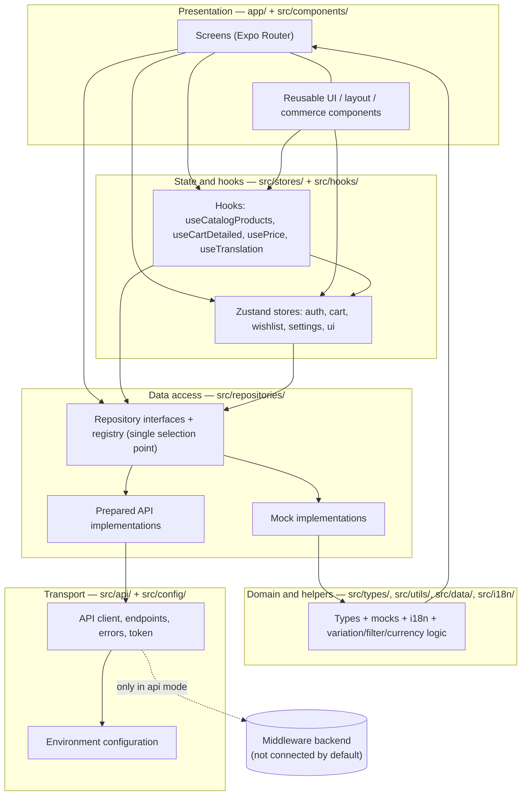
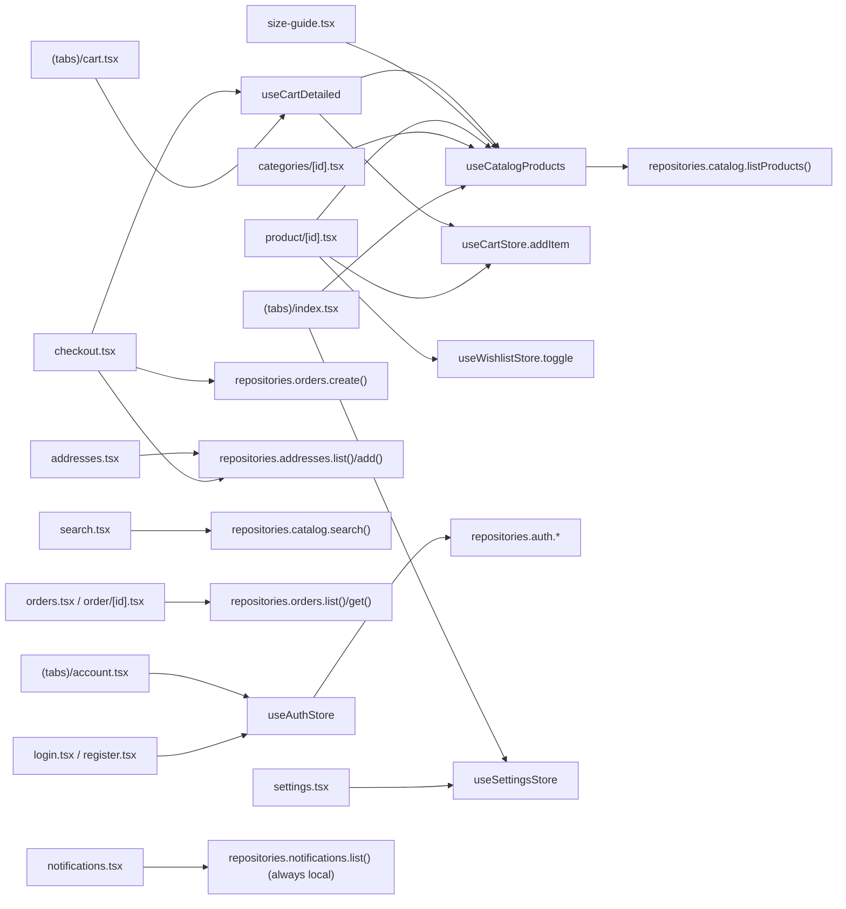
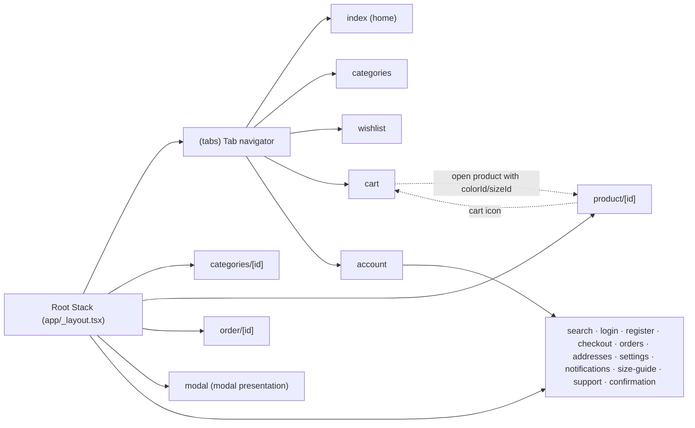

# Architecture

> Source of truth: the source files listed here. This document describes the application as implemented, including prepared-but-unwired API components. See [API_INTEGRATION.md](API_INTEGRATION.md) for the backend contract boundary.

## 1. Overall architecture

The application is a **layered, screen-driven Expo Router app** with a repository abstraction over two data sources (`mock` by default, `api` opt-in). Screens render domain models (`Product`, `CartItem`, `Order`, `User`, …) that never contain raw API shapes.

The dominant flow for catalogue data is:

```
Screen → Hook (useCatalogProducts) → Repository (repositories.catalog)
       → [mock data | API client → backend] → Mappers (API only) → Screen
```

Important exceptions (documented precisely because they are easy to misstate):

- **Cart and wishlist never travel through a repository in the UI.** Screens call Zustand store actions directly.
- **Checkout** writes an order through `repositories.orders.create(order)`; in mock mode this persists to AsyncStorage, in API mode it would POST to the documented orders endpoint.
- **Addresses, search, orders, auth** call repositories directly from screens or stores.
- **Profile, store config, cart repository and notifications API implementations are prepared but not wired to screens** (notifications are always local).



## 2. Main layers and responsibilities

| Layer | Location | Responsibility |
|---|---|---|
| Routing / screens | `app/` | File-based routes, navigation, screen state, composition of components and hooks. |
| Reusable UI | `src/components/ui/` | `AppText`, `AppTextInput`, `Button`, `Icon`, `IconButton`, `Screen`, `PageHeader`, `BackButton`, dialogs, `ModalSheet`. |
| Layout | `src/components/layout/` | `HomeHeader`, animated `BottomNav`. |
| Commerce UI | `src/components/commerce/` | `ProductCard` / `ProductGrid`, `ProductImage`, `QuantityStepper`, `CurrencySheet`, `SectionHeader`, `SummaryRow`, `EmptyState`. |
| Hooks | `src/hooks/` | Cross-cutting derived state: translation, price formatting, cart join/totals, catalogue loading with cache. |
| Global state | `src/stores/` | Zustand stores; three persisted to AsyncStorage, two in-memory. |
| Domain models | `src/types/index.ts` | `Product`, `ProductColor`, `SizeOption`, `ProductVariation`, `CartItem`, `Order`, `Address`, `User`, `Lang`, `CurrencyCode`, … |
| Business logic | `src/utils/` | Variation resolution, filtering, currency conversion, validation, formatting. |
| Mock data | `src/data/`, `store-configs/` | Products, categories, seed orders/addresses/notifications, image helpers, white-label config. |
| Data access contracts | `src/repositories/types.ts` | `AuthRepository`, `CatalogRepository`, `CartRepository`, `ProfileRepository`, `StoreConfigRepository`, `OrderRepository`, `AddressRepository`, `NotificationRepository`, `RepoResult<T>`. |
| Repository registry | `src/repositories/index.ts` | Chooses mock or API set, installs fallback proxy and JWT provider. |
| Mock implementations | `src/repositories/mock*.ts` | Local catalogue, local demo auth, AsyncStorage-backed orders/addresses, local prepared contracts. |
| API implementations | `src/repositories/api*.ts` | Documented endpoints only; validate responses and map them to domain models. |
| API transport | `src/api/` | `client.ts`, `endpoints.ts`, `types.ts`, `errors.ts`, `errorMessages.ts`, `mappers.ts`, `token.ts`. |
| Configuration | `src/config/environment.ts`, `.env.example`, `app.json`, `eas.json` | Data-source selection, base URL, store ID, timeout, app identity, EAS profiles. |
| Localization | `src/i18n/translations.ts`, `src/hooks/useTranslation.ts`, `src/theme/typography.ts` | All UI copy, RTL state, font selection. |
| Tests | `tests/` | Jest suites for API layers, commerce, variations, filtering, RTL, settings. |

## 3. Folder and important file responsibilities

### 3.1 `app/` — routing

Expo Router file conventions map directly to URLs:

| File / folder | Route | Role |
|---|---|---|
| `app/_layout.tsx` | root | Loads fonts, hides splash after settings hydration, restores auth session, applies root `direction`, declares the Stack. |
| `app/(tabs)/_layout.tsx` | tab group | Five tabs; uses the custom `BottomNav` as `tabBar`. |
| `app/(tabs)/index.tsx` | `/` | Home: hero, category strip, new arrivals, language/currency/login/logout entry points. |
| `app/(tabs)/categories.tsx` | `/categories` | Category tiles and subcategory links. |
| `app/(tabs)/wishlist.tsx` | `/wishlist` | Local wishlist with quick add-to-cart. |
| `app/(tabs)/cart.tsx` | `/cart` | Variation-aware bag, quantity steppers, summary, checkout guard. |
| `app/(tabs)/account.tsx` | `/account` | Guest prompt or profile menu; reads the auth user directly. |
| `app/categories/[id].tsx` | `/categories/:id` | Dynamic listing with subcategory, sort and real filters. |
| `app/product/[id].tsx` | `/product/:id` | Product detail, colour/size/gallery, stock, add to cart. |
| `app/order/[id].tsx` | `/order/:id` | Order detail and status timeline. |
| `app/search.tsx`, `app/checkout.tsx`, `app/orders.tsx`, `app/addresses.tsx`, `app/settings.tsx`, `app/notifications.tsx`, `app/size-guide.tsx`, `app/support.tsx`, `app/confirmation.tsx`, `app/login.tsx`, `app/register.tsx` | named routes | Feature screens described in [FEATURES.md](FEATURES.md). |
| `app/modal.tsx` | `/modal` | Modal presentation demo (`presentation: 'modal'`). |
| `app/+not-found.tsx` | unknown | Fallback screen. |
| `app/+html.tsx` | web | Web document shell. |
| `app/(tabs)/two.tsx` | `/two` | Template leftover, **not registered** in the tab navigator. |

`unstable_settings.anchor = '(tabs)'` makes the tab group the initial route. `experiments.typedRoutes` is `false` in `app.json`; `extra.router.asyncRoutes.web` is `true`.

### 3.2 `src/api/` — transport boundary

| File | Responsibility |
|---|---|
| `client.ts` | Owns base URL, store ID, timeout, JSON headers, Bearer token provider, unauthorized and connection-failure handlers, safe error normalization. Exposes `request<T>`, `apiClient.get/post/put/delete`, `buildUrl`, `assertApiReady`, `configureApi`. |
| `endpoints.ts` | `API_PATHS` — only routes present in `API.md`, all rooted at `/v1/store/:storeId`. |
| `types.ts` | Remote DTOs (e.g. `ApiProduct`, `ApiCart`, `ApiOrder`) mirroring `API.md`. |
| `errors.ts` | `ApiError`, `normalizeApiError`, `httpError`, `configurationError`, `shouldFallbackToMock`, status→message map. |
| `errorMessages.ts` | `apiErrorTranslationKey(error)` maps errors to `TranslationKey`. |
| `mappers.ts` | `mapApiProduct`, `mapApiProductPage`, `mapApiCategory`, `mapApiCustomer`, `mapApiAddress`, `mapApiCart`, `mapApiOrder`, `mapApiStoreConfig`, stable remote↔local ID registry. |
| `token.ts` | SecureStore-backed customer JWT (`naseej:customer-jwt`), separate from the demo session key. |

### 3.3 `src/repositories/` — data access boundary

`repositories/types.ts` defines the contracts. `repositories/index.ts` exports a single `repositories` object with getters that resolve to the active set on every access:

- `mockSet`: mock implementations for every contract; notifications are always local in both modes.
- `resilientApiSet`: API implementations wrapped by `withMockFallback`.
- `activeSet()`: API set only when `dataSource === 'api'` **and** no connection failure has occurred; otherwise mock set.
- `getRepositorySource()`: `'api'` or `'mock'` — used by screens to show a source notice.
- `resetRepositoryFallbackForTests()`, `configureEnvironment()`, `resetEnvironment()`, `resetApiClientForTests()`, `resetRemoteIdRegistry()` are test hooks; the app never calls them.

### 3.4 `src/stores/` — state

See [STATE_MANAGEMENT.md](STATE_MANAGEMENT.md) for the full store/action reference.

### 3.5 `src/utils/` — pure logic

- `productVariants.ts`: the single source of truth for colour/size resolution, price priority, stock, availability, SKU and images.
- `filterProducts.ts`: category/subcategory/price/colour/size/stock/discount filters and price ranges.
- `currency.ts`: SAR-based conversion with integer minor units and `createPriceFormatter`.
- `validation.ts`: email/password and phone/OTP validation (OTP is exactly 4 digits).
- `format.ts`: `pick` (localized field), `measurement`, `discountPercent`, `variantLineId`, `demoOrderNumber`.

## 4. Relationships between screens, components, hooks, stores and repositories



Notes on the diagram:

- `useCartDetailed(products)` joins `useCartStore.items` with the catalogue passed in by the screen; it computes `subtotalSar` and `count` but does **not** mutate state.
- `useCatalogProducts()` has a module-level `catalogCache` and `catalogInflight`; the first successful load is reused by all screens until `retry()` clears it.
- Price display is deliberately central: every screen uses `usePrice()` → `createPriceFormatter(lang, currency)` → `formatPrice(baseSar, ...)`.

## 5. Navigation architecture

- **Root Stack** (`app/_layout.tsx`) declares every non-tab screen with `headerShown: false`; `/modal` uses `presentation: 'modal'`.
- **Tab navigator** (`app/(tabs)/_layout.tsx`) registers `index`, `categories`, `wishlist`, `cart`, `account` and renders `BottomNav`.
- **Custom tab bar** (`src/components/layout/BottomNav.tsx`): one logical tab order `[categories, wishlist, home, cart, account]`; the row's `direction` flips physical placement for Arabic so Home stays centred. A single Reanimated shared value drives a 44px indicator; native uses a pixel `translateX` transform, web uses a percentage `left`. The active Expo Router route is the only source of truth for the indicator.
- **Dynamic routes** use `useLocalSearchParams` (`id`, `subcategory`, `colorId`, `sizeId`, `orderId`).
- **Route params as state**: category subcategory filters are stored in the `subcategory` query param via `router.setParams`; the product screen accepts optional `colorId` / `sizeId` params to preselect a variant (used by the cart screen's "open product" action).



## 6. Localization and RTL/LTR architecture

| Concern | Implementation |
|---|---|
| Copy | Every user-facing string lives in `src/i18n/translations.ts` (`as const`); `TranslationKey = keyof typeof translations`; `translate(lang, key)`. |
| Hook | `useTranslation()` reads `useSettingsStore.lang`, returns `{ t, lang, isRTL, dir }`; Arabic ⇒ RTL. |
| Persistence | `useSettingsStore` (`persist`, AsyncStorage key `naseej:settings`) stores `lang`, `currency`, `unit`. |
| Root direction | `app/_layout.tsx` wraps the navigator in a `View` with `direction: rtl/ltr` and sets `document.documentElement.lang/dir` on web. |
| Screen direction | `Screen` (and `PageHeader`, `AppText`, `AppTextInput`, dialogs, sheets) propagates `direction` from the store. |
| Native | `I18nManager.allowRTL(true)` is called on native; `forceRTL` + reload are intentionally **not** used, so language switches without a restart. |
| Fonts | `fontFamilyFor(lang, …)` in `src/theme/typography.ts`: Noto Sans Arabic for Arabic, DM Sans for Latin body, Playfair Display for Latin serif headings. |
| Directional icons | `Icon` accepts a `direction` prop; `BottomNav` reverses the physical tab order for RTL while keeping one logical order. |
| Numeric content | Phone and OTP inputs are deliberately rendered LTR; the confirmation screen forces `direction: 'ltr'` for the demo order number. |
| Startup gating | Splash hides only after fonts load and settings hydration completes (`useSyncExternalStore` on `useSettingsStore.persist`). |

`tests/rtlLayout.test.tsx`, `tests/settingsStore.test.ts` and `tests/rtl-checklist.md` document the verified web/shared-component behaviour; a native-device visual pass is still outstanding.

## 7. Error and configuration boundaries

- `src/config/environment.ts`: `readEnvironment()` parses `EXPO_PUBLIC_*`; only exact lowercase `api` opts in; URL trailing slashes are stripped; invalid timeouts fall back to `15000`.
- `src/api/client.ts`: `assertApiReady()` refuses to build a request without base URL and store ID; `request()` normalizes every thrown value into `ApiError` and notifies the connection-failure handler only for connectivity/server failures.
- `src/api/errors.ts` + `errorMessages.ts`: safe messages only; no token, body or raw server text is logged or surfaced.
- `src/repositories/index.ts`: `withMockFallback` is a `Proxy` that routes every API repository method through a guard: mock when already failed or not in API mode; otherwise call API and fall back to the matching mock method for fallback-eligible errors.

## 8. Mermaid quick reference

Diagrams in this set:

- Architecture layers — this document, §1.
- Navigation graph — this document, §5.
- Feature/data flows — [DATA_FLOW.md](DATA_FLOW.md).
- Store relationships — [STATE_MANAGEMENT.md](STATE_MANAGEMENT.md).

All diagrams describe implemented code paths; prepared-but-unwired paths are marked explicitly.
