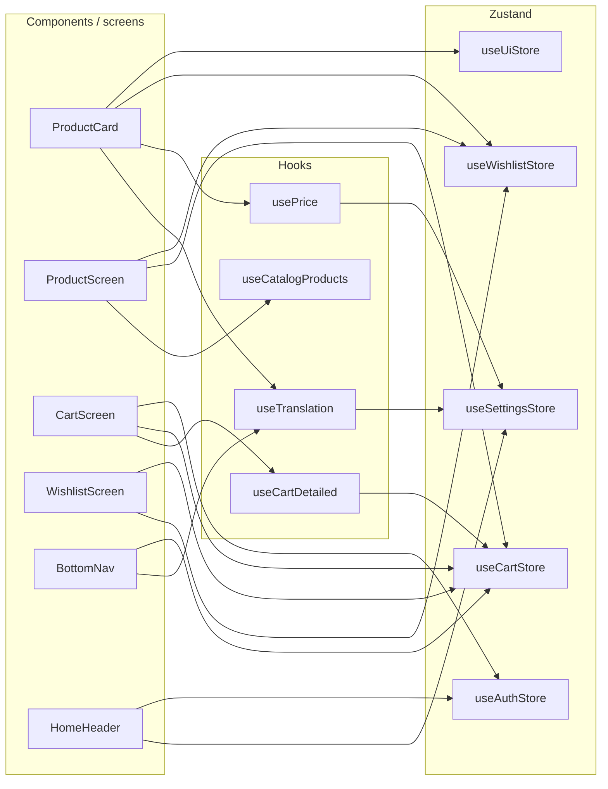
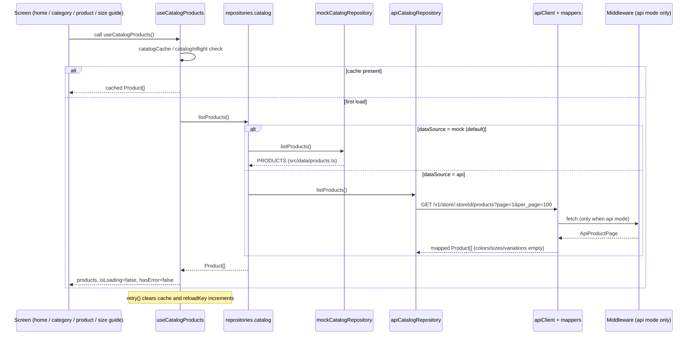
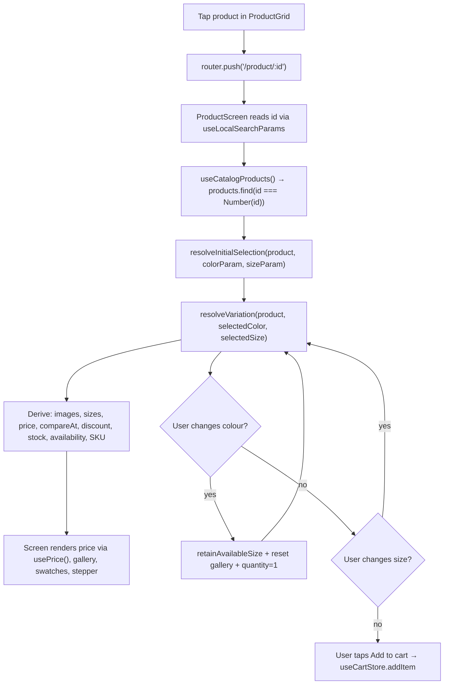
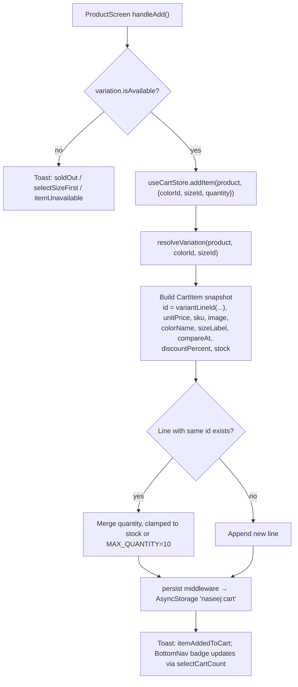
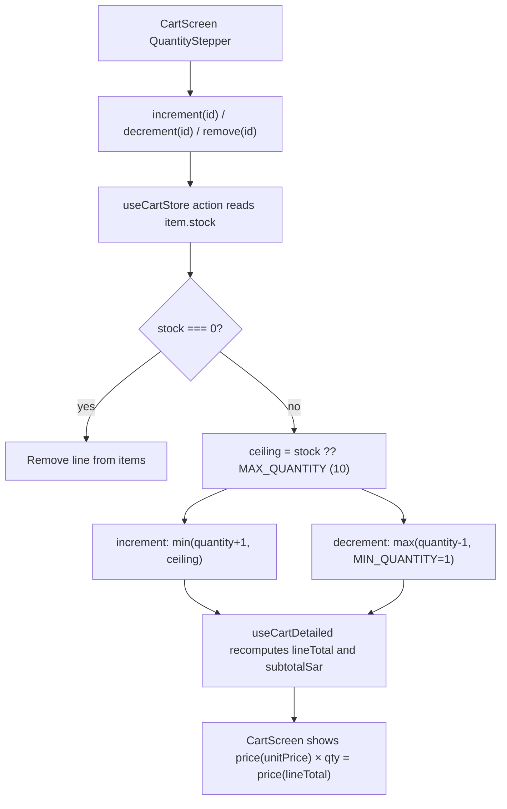
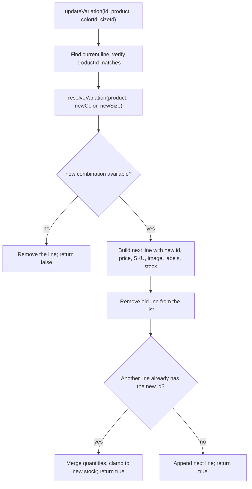
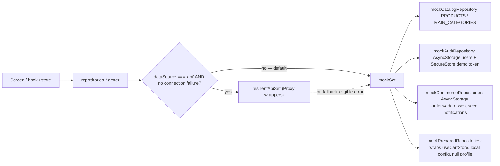

# Data Flow

> This document explains how data moves through the **actual** implementation. Prepared-but-unwired paths are labelled. Related reading: [ARCHITECTURE.md](ARCHITECTURE.md), [STATE_MANAGEMENT.md](STATE_MANAGEMENT.md), [API_INTEGRATION.md](API_INTEGRATION.md).

## 1. The short version

There are three distinct data paths in this app:

| Path | Used by | Wired to screens? |
|---|---|---|
| `Screen → Hook → Repository → (mock data)` | Catalogue, home, category listing, product detail, size guide | Yes |
| `Screen → Repository → AsyncStorage / API client` | Search, addresses, orders, auth, checkout order creation | Yes |
| `Screen → Zustand store (→ AsyncStorage)` | Cart, wishlist, settings, toasts | Yes — this path never touches a repository in screens |

The "Screen → Hook → Repository → API Client → Backend" chain described in generic guides is real **only for catalogue data in API mode** (and for repository-backed features listed above). The cart and wishlist intentionally bypass it.

## 2. Screen-to-data map

| Screen | Gets data from | Writes data to |
|---|---|---|
| `(tabs)/index` | `useCatalogProducts()`, `MAIN_CATEGORIES`, `getRepositorySource()` | settings (language/currency), auth (logout), UI toast |
| `(tabs)/categories` | `MAIN_CATEGORIES` | — |
| `categories/[id]` | `useCatalogProducts()` + `filterProducts()` | route param `subcategory` |
| `product/[id]` | `useCatalogProducts()` | `useCartStore.addItem`, `useWishlistStore.toggle`, UI toast |
| `search` | `repositories.catalog.search()` | local component state |
| `(tabs)/cart` | `useCartDetailed(products)` | `useCartStore` quantity/remove actions |
| `(tabs)/wishlist` | `useWishlistStore.ids` + catalogue | wishlist toggle, `useCartStore.addItem` |
| `checkout` | `repositories.addresses.list()`, `useCartDetailed` | `repositories.addresses.add`, `repositories.orders.create`, `useCartStore.clear` |
| `orders`, `order/[id]` | `repositories.orders.list()/get()` | — |
| `addresses` | `repositories.addresses.list()/add()` | AsyncStorage or API |
| `login`, `register` | `useAuthStore` actions | auth store → repository → SecureStore |
| `settings`, `size-guide` | `useSettingsStore`, `useCatalogProducts()` | settings store |
| `notifications` | `repositories.notifications.list()` (always local) | local "read" state only |

## 3. Component → hook → store relationships



## 4. Loading products (catalogue flow)



**In plain terms:** the first screen that needs products asks `useCatalogProducts()`. That hook keeps a module-level cache so later screens do not re-fetch. It calls the repository interface, which resolves to mock data (default) or prepared API code. API results are converted by mappers into the same `Product[]` the screens already understand. Errors set `hasError` and the UI shows a retry button.

`useCatalogProducts()` does not filter or sort; category and search screens do that themselves using `filterProducts` / `getProductsByRoute` / `repositories.catalog.search`.

## 5. Opening product details



**In plain terms:** the route id selects a product from the shared catalogue. The selected colour/size is passed to one function, `resolveVariation`, which returns every derived value the screen needs. Changing a colour can invalidate the previously chosen size, so the helper `retainAvailableSize` clears it when needed. The gallery resets to the first image of the new colour.

## 6. Adding a product to the cart



**In plain terms:** the screen checks availability, then the store recomputes the variation once and stores a *snapshot*. Identical variants merge into one line; different colour/size combinations stay separate. Zustand's `persist` middleware writes the updated cart to AsyncStorage. The bottom navigation badge subscribes with a narrow selector and updates automatically.

## 7. Updating cart quantity



**In plain terms:** quantity actions never trust the UI's displayed maximum. They re-read the stock snapshot stored on the line, clamp to 1–10 (or to the known stock), and remove a confirmed out-of-stock line. `useCartDetailed` memoizes the join and totals, so the summary updates without recalculating unrelated state.

## 8. Changing a product's colour or size in the cart

There is no in-place variant picker on the cart screen. The cart opens `/product/[id]` with `colorId`/`sizeId` params; the product screen preselects that combination. A variant change inside a cart line can be performed programmatically through `useCartStore.updateVariation(id, product, colorId, sizeId)`:



**In plain terms:** changing a variant is treated as moving a line to a new identity. If the destination already exists the quantities are added (nothing is lost); if the new combination is unavailable the line is removed rather than left in an invalid state.

## 9. Mock repository flow



**In plain terms:** `repositories` is a facade whose getters choose a set on each access. In mock mode all calls read local files or AsyncStorage. Even in API mode, a connectivity failure flips a module flag so subsequent calls use the mock set for the rest of the session.

## 10. API request/response flow (api mode only)

```mermaid
sequenceDiagram
    participant S as Screen / store
    participant R as repositories.catalog / auth / orders ...
    participant W as withMockFallback Proxy
    participant C as apiClient.request
    participant T as token.ts (SecureStore)
    participant E as endpoints.ts + environment.ts
    participant B as Backend

    S->>R: method call
    R->>W: proxied method
    W->>W: connectionFailed? dataSource !== 'api'? → use mock
    W->>C: api method
    C->>E: assertApiReady() + buildUrl(path, query)
    C->>T: resolved token (if provider installed)
    C->>B: fetch(GET/POST/PUT/DELETE, JSON headers, Bearer, timeout)
    alt 2xx
        B-->>C: JSON text
        C-->>R: parsed T (empty body → undefined)
        R->>R: validate shape, map via src/api/mappers.ts
        R-->>S: domain model
    else 401/403
        C->>T: unauthorizedHandler → clearCustomerToken()
        C-->>W: ApiError (no fallback)
    else 500/502/503/504 or network/timeout/invalid-response/not-configured
        C->>W: connectionFailureHandler()
        W->>W: connectionFailed = true
        W->>M: call matching mock method
        M-->>S: local data
    else 400/404/429
        C-->>W: ApiError (no fallback; 404 → undefined in getProduct/get order)
    end
```

**In plain terms:** every API repository call goes through a proxy. The client builds the URL from the environment, adds a Bearer token when available, applies a timeout and normalizes errors. Only infrastructure-type failures switch to mock; validation/auth/not-found errors remain errors so the UI does not pretend they succeeded.

## 11. Error handling

| Layer | Mechanism | Result |
|---|---|---|
| API client | `ApiError`, `normalizeApiError`, `httpError`, `configurationError` | Safe, fixed messages; no raw body/token logged. |
| Error → UI | `apiErrorTranslationKey()` + `useTranslation().t()` | Translated key such as `apiNetworkError`, `apiUnauthorized`, `apiUnavailable`. |
| Repository registry | `shouldFallbackToMock()` + `connectionFailureHandler` | Session-wide switch to mock for connectivity/server failures. |
| Hooks | `useCatalogProducts` `hasError` + `retry()` | Retry control on home/category/product/size-guide. |
| Screens | Local state and toasts | Auth prompts, "sold out"/"unavailable" toasts, empty states. |
| Storage | `try/catch` in repositories | Persistence failures do not crash the app. |

## 12. Persistence map

| Key | Storage | Written by | Notes |
|---|---|---|---|
| `naseej:cart` | AsyncStorage | `useCartStore` (zustand persist) | Version 2; `migrate` enriches older lines with variation snapshots. |
| `naseej:wishlist` | AsyncStorage | `useWishlistStore` | Version 1; array of product ids. |
| `naseej:settings` | AsyncStorage | `useSettingsStore` | `lang`, `currency`, `unit`; hydration gates splash. |
| `naseej:users` | AsyncStorage | `mockAuthRepository` | Public profile fields only; no passwords. |
| `naseej:session` | SecureStore | `mockAuthRepository` | Predictable demo token; separate from JWT. |
| `naseej:customer-jwt` | SecureStore | `src/api/token.ts` | Real API JWT, only in api mode; cleared on 401/403. |
| `naseej:orders` | AsyncStorage | `mockOrderRepository` | Demo orders including locally created ones. |
| `naseej:addresses` | AsyncStorage | `mockAddressRepository` | Shared demo addresses (not per-user scoped). |

## 13. Notable flow limitations

- **No server pagination in the UI.** `listProductsPaged` exists in both repositories and is tested, but screens load the full list via `listProducts()` (100 items max in API mode) and filter locally.
- **No debounce in search.** `app/search.tsx` calls the repository on every keystroke.
- **No runtime source switch.** Changing `EXPO_PUBLIC_DATA_SOURCE` requires an app restart; there is no in-app toggle.
- **Fallback is sticky.** `connectionFailed` is reset only by `resetRepositoryFallbackForTests()`; no automatic recovery occurs in the same session.
- **Source notice is render-derived.** The home screen reads `getRepositorySource()` during render, so a fallback that happens without another state change may not immediately re-label the notice.
