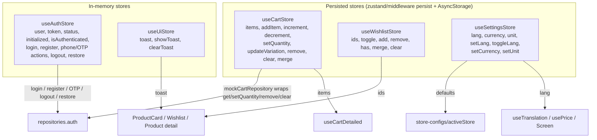

# State Management

> All application state uses **Zustand 5** (`^5.1.0`). There is no Redux, Context store, or React Query usage in the source, even though `@tanstack/react-query` is declared in `package.json`. See [DATA_FLOW.md](DATA_FLOW.md) for how state participates in end-to-end flows.

## 1. Overview

| Store | File | Persistence | Purpose |
|---|---|---|---|
| `useAuthStore` | `src/stores/authStore.ts` | None (session restored from repository) | Demo/API user, token, auth status. |
| `useCartStore` | `src/stores/cartStore.ts` | AsyncStorage `naseej:cart`, version 2 | Variation-aware shopping bag. |
| `useWishlistStore` | `src/stores/wishlistStore.ts` | AsyncStorage `naseej:wishlist`, version 1 | Saved product ids. |
| `useSettingsStore` | `src/stores/settingsStore.ts` | AsyncStorage `naseej:settings` | Language, currency, measurement unit. |
| `useUiStore` | `src/stores/uiStore.ts` | None | Global toast notifications. |



## 2. `useAuthStore`

**Interface:** `AuthState` (private to the file).

| State property | Type | Initial value | Meaning |
|---|---|---|---|
| `user` | `User \| null` | `null` | Current customer profile. |
| `token` | `string \| null` | `null` | Demo or API token. |
| `status` | `AuthStatus` = `"idle" \| "authenticating"` | `"idle"` | Drives screen loading indicators. |
| `initialized` | `boolean` | `false` | Set true by `restore()`. |
| `isAuthenticated` | `boolean` | `false` | Derived guard used by checkout/account/header. |

| Action | Signature | Behaviour |
|---|---|---|
| `login` | `(email, password) => Promise<TranslationKey \| null>` | Calls `repositories.auth.login`; stores user/token on success. Not called by current screens. |
| `register` | `(name, email, password) => Promise<TranslationKey \| null>` | Same via `repositories.auth.register`. Not called by current screens. |
| `loginWithPhone` | `(phone) => Promise<TranslationKey \| null>` | Lookup + request OTP; no user set until verification. |
| `registerWithPhone` | `(input: PhoneRegistrationInput) => Promise<TranslationKey \| null>` | Create local demo profile, then request OTP. |
| `requestOtp` | `(phone) => Promise<TranslationKey \| null>` | Resend OTP. |
| `verifyOtp` | `(phone, code) => Promise<TranslationKey \| null>` | Sets `user`, `token`, `isAuthenticated` on success. |
| `logout` | `() => Promise<void>` | Calls repository logout, clears auth state, **preserves cart and wishlist**. |
| `restore` | `() => Promise<void>` | Reads persisted session; sets `initialized: true`. Called once by `app/_layout.tsx`. |

**Business rules.** Actions return a `TranslationKey` on failure (or `null` on success) rather than throwing, so screens can call `t(error)` directly. During an action, `status` is `"authenticating"`. `restore()` keeps existing user/token when no session is found. There is no persistence middleware here; the repository decides where the session lives.

**Consumers.** `app/(tabs)/account.tsx`, `app/(tabs)/index.tsx`, `app/(tabs)/cart.tsx`, `app/checkout.tsx`, `app/login.tsx`, `app/register.tsx`, `src/components/layout/HomeHeader.tsx`, `app/_layout.tsx`.

## 3. `useCartStore`

**Interface:** `CartState`. Constants: `MAX_QUANTITY = 10`, `MIN_QUANTITY = 1`. Helper type: `AddOptions { colorId?: string | null; sizeId?: string | null; quantity?: number }`.

| State property | Type | Meaning |
|---|---|---|
| `items` | `CartItem[]` | One line per exact colour/size combination; see `variantLineId` in `src/utils/format.ts`. |

| Action | Signature | Behaviour |
|---|---|---|
| `addItem` | `(product: Product, options?: AddOptions) => boolean` | Resolves the variation, snapshots its data, merges or appends a line. Returns `false` if unavailable. |
| `increment` | `(id: string) => void` | Adds 1, clamped to stock/10; removes a line with stock `0`. |
| `decrement` | `(id: string) => void` | Subtracts 1, never below 1; removes a line with stock `0`. |
| `setQuantity` | `(id: string, quantity: number) => void` | Sets quantity, clamps to `[1, ceiling]`; removes stock-0 lines. |
| `updateVariation` | `(id, product, colorId, sizeId) => boolean` | Moves a line to a new variant, recomputes all snapshot fields, merges if the target exists, removes if unavailable. |
| `remove` | `(id: string) => void` | Removes one line. |
| `clear` | `() => void` | Empties the cart (used by checkout). |
| `merge` | `(items: CartItem[]) => void` | Dedupe/merge helper for guest data restoration. |

**Persistence.** `persist(createJSONStorage(() => AsyncStorage), { name: "naseej:cart", version: 2, migrate })`. The `migrate` function backfills variation snapshot fields on carts written before the variation system (`unitPrice`, `sku`, `image`, labels, stock, discounts) using `getProductById` + `resolveVariation`.

**Business rules.**
- `clampQuantity(q, ceiling = MAX_QUANTITY)` rounds and clamps to `[1, ceiling]`.
- Stock ceiling comes from the line's `stock` snapshot (null → 10); unknown stock is **not** treated as out of stock.
- `addItemToItems` merges on identical `item.id`; the stock limit considers both the new item and existing line.
- All displayed line data (`unitPrice`, `colorName`, `sizeLabel`, `image`, `sku`) is stored, not recomputed on every render — later price edits on a product do not rewrite old cart lines.
- `selectCartCount(state)` is exported outside the store so `BottomNav` subscribes narrowly: `useCartStore(selectCartCount)`.

**Consumers.** `app/(tabs)/cart.tsx`, `app/product/[id].tsx`, `app/(tabs)/wishlist.tsx`, `app/checkout.tsx`, `src/components/layout/BottomNav.tsx`, `src/hooks/useCartDetailed.ts`, `src/repositories/mockPreparedRepositories.ts` (via `useCartStore.getState()`).

## 4. `useWishlistStore`

**Interface:** `WishlistState`.

| State property | Type | Meaning |
|---|---|---|
| `ids` | `number[]` | Product ids in save order, no duplicates. |

| Action | Signature | Behaviour |
|---|---|---|
| `toggle` | `(productId: number) => void` | Adds if absent, removes if present. |
| `add` | `(productId: number) => void` | Idempotent add. |
| `remove` | `(productId: number) => void` | Removes id. |
| `has` | `(productId: number) => boolean` | Reads current `ids` via `get()`. |
| `merge` | `(ids: number[]) => void` | Unions with existing ids (`Set`). |
| `clear` | `() => void` | Empties the list. |

**Persistence.** `persist(createJSONStorage(() => AsyncStorage), { name: "naseej:wishlist", version: 1 })`.

**Business rules.** Stores ids only — no product snapshots. Screens resolve ids against the loaded catalogue, so deleted/renamed products are skipped. There are no server endpoints; this store is authoritative in both modes.

**Consumers.** `ProductCard`, `app/product/[id].tsx`, `app/(tabs)/wishlist.tsx`, `tests/commerce.test.ts`.

## 5. `useSettingsStore`

**Interface:** `SettingsState`.

| State property | Type | Initial value |
|---|---|---|
| `lang` | `Lang` (`"ar" \| "en"`) | `activeStore.defaultLanguage` (`"ar"`) |
| `currency` | `CurrencyCode` | `activeStore.defaultCurrency` (`"SAR"`) |
| `unit` | `"cm" \| "in"` | `"cm"` |

| Action | Signature | Behaviour |
|---|---|---|
| `setLang` | `(lang: Lang) => void` | Sets language. |
| `toggleLang` | `() => void` | Switches `ar` ↔ `en`. |
| `setCurrency` | `(currency: CurrencyCode) => void` | Sets display currency. |
| `setUnit` | `(unit: "cm" \| "in") => void` | Sets size-guide unit. |

**Persistence.** `persist(createJSONStorage(() => AsyncStorage), { name: "naseej:settings" })` (no explicit version).

**Startup importance.** `app/_layout.tsx` waits on `useSettingsStore.persist.onFinishHydration` / `hasHydrated()` before hiding the splash, preventing a visible language/direction flash.

**Consumers.** `useTranslation`, `usePrice`, `Screen`, `AppText`, `AppTextInput`, `PageHeader`, `BackButton`, dialogs/sheets, `HomeHeader`, `app/settings.tsx`, `app/size-guide.tsx`, `src/components/layout/BottomNav.tsx`, `app/_layout.tsx`.

## 6. `useUiStore`

**Interface:** `ToastState`.

| State property | Type | Meaning |
|---|---|---|
| `toast` | `{ id: number; message: string } \| null` | Current global toast; `id` increments through a module-level counter. |

| Action | Signature | Behaviour |
|---|---|---|
| `showToast` | `(message: string) => void` | Creates a toast with a new id. |
| `clearToast` | `() => void` | Clears the toast. |

Not persisted. Used by cart, wishlist, product, home, checkout, currency sheet and settings flows.

## 7. How components subscribe to updates

The project uses narrow selectors rather than subscribing to whole stores:

```ts
const items = useCartStore((s) => s.items);
const count = useCartStore(selectCartCount);
const toggleLang = useSettingsStore((s) => s.toggleLang);
const isFavorite = useWishlistStore((s) => s.ids.includes(product?.id ?? 0));
```

- Component code calls actions directly from the hook, e.g. `useCartStore.getState().setQuantity(...)` inside `mockCartRepository` for non-React code.
- Derived data is memoized outside the stores: `useCartDetailed(products)` uses `useMemo([items, products])`; `usePrice()` and `useTranslation()` use `useMemo` keyed on settings.
- `ProductCard` is wrapped in `React.memo`, and `ProductGrid` memoizes its row construction.

## 8. Safely adding a new store or state property

1. **Choose the right home.** Put cross-screen UI feedback in `useUiStore`; user/session data in `useAuthStore`; persisted customer data in a new persisted store following the existing pattern.
2. **Define the interface next to the store** (e.g. `interface MyState { ... }`) and type the creator: `create<MyState>()(...)`.
3. **For persistence**, wrap the initializer with `persist((set, get) => ({...}), { name: "naseej:<feature>", storage: createJSONStorage(() => AsyncStorage), version: 1 })`. Keep keys prefixed `naseej:`.
4. **When changing a persisted shape**, bump `version` and add a `migrate(persistedState, version)` function that fills missing fields, as `cartStore.ts` does. Never silently reinterpret old data.
5. **Add actions that return status where useful** (`boolean` or `TranslationKey | null`) rather than throwing, matching the existing store conventions.
6. **Keep derived values out of state.** Compute them in hooks with `useMemo`, or export selector helpers outside the store (see `selectCartCount`).
7. **Keep IDs stable.** Variant lines must use `variantLineId`; wishlist uses numeric product ids; API remote ids are mapped in `src/api/mappers.ts`.
8. **Add tests** in `tests/` covering the new action, persistence/migration edge cases and any clamping/business rules.
9. **Update documentation** in this file, [FEATURES.md](FEATURES.md) and [DATA_FLOW.md](DATA_FLOW.md) with the new property/action names.

## 9. Do not confuse these boundaries

- `useAuthStore.token` holds a demo token (`naseej:session`) or an API token; the API client reads its own provider from `src/api/token.ts` (`naseej:customer-jwt`). They are deliberately separate.
- `useCartStore` is the cart authority for the UI; `CartRepository` implementations are prepared for future server sync and are not used by screens.
- `useSettingsStore.currency` affects display only; all persisted prices and order totals stay in SAR.
